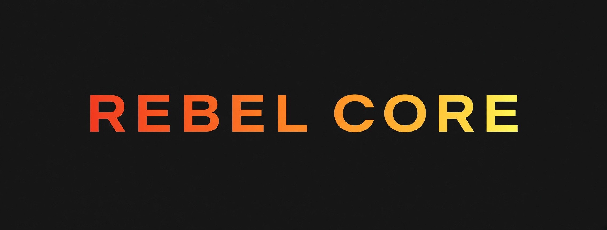

<!--
  rebel-core
  Unraid WebUI skin · CSS theming · Self-hosted
  Template: README template v1.0
-->

<div align="center">
  
</div>

<br/>

<p align="center">
  
  
  
  
  
</p>

---

## Abstract

The stock Unraid web interface has no easy way to carry a personal look, and a custom skin is only useful if it survives reboots and can load its own logo. This repository holds **Emerald Void**, a dark, near-black skin with emerald metrics and crimson alerts for Unraid 7.2+ via the ThemeUI plugin, together with the **REBEL CORE** logo and a stable hosted URL for it. The skin is one CSS file that follows ThemeUI's variable contract, with an optional install script that registers it in ThemeUI's picker. An offline build embeds the logo as a `data:` URI, so a server with no internet access can still show it. The CSS, the logo URL and the image files are checked by `make test` on every commit.

> **Design intent:** One skin file, one logo URL, and a local fallback that needs no network.

---

## Project Dashboard

<div align="center">

| Metric | Target | Current | Δ |
|:-------|:------:|:-------:|:--:|
| **Skin checks passing (`make test`)** | all | all | on target |
| **Hosted logo URL resolves** | 200 OK | pending first push | pending |
| **Verified on a live Unraid server** | yes | not yet | open |
| **Secrets in repository** | 0 | 0 | — |
| **PII-guard hits (tree)** | 0 | 0 | — |
| **Open Risks (High)** | 0 | 0 | — |

</div>

---

## Scope & Objectives

**In scope**

- Ship the Emerald Void skin as a single CSS file valid as a ThemeUI Custom CSS Override or a drop-in theme.
- Host the REBEL CORE logo at a stable public URL and reference it from the CSS.
- Provide an offline build (`make local-css`) that embeds the logo, with no network dependency.
- Provide a static HTML preview of the palette that opens from a clone with no server.

**Explicitly out of scope**

- Patching Unraid itself or any plugin other than via ThemeUI's documented override and the optional install script.
- Any server-side component, telemetry, or account.

**Success criteria** — the project is *done* when the skin applies on an Unraid 7.2+ server through ThemeUI and the logo shows both from the hosted URL and from the offline build.

---

## System Architecture

```text
┌──────────────────────┐   make local-css   ┌────────────────────────────┐
│ src/emerald-void.css │──────────────────▶│ dist/emerald-void.local.css │  logo embedded (data: URI)
│ --rc-logo → hosted   │                    └────────────────────────────┘
└──────────┬───────────┘
           │ paste / drop-in                ┌────────────────────────────┐
           ▼                                │ assets/rebel-core-logo.png │  served by raw.githubusercontent.com
   ThemeUI (Unraid 7.2+) ◀── logo URL ──────│ assets/rebel-core-banner.jpg│  (README banner)
                                            └────────────────────────────┘
```

| Layer | Component | Interface / Protocol | Notes |
|:------|:----------|:---------------------|:------|
| Skin | `src/emerald-void.css` | ThemeUI variable contract + CSS | `--rc-logo` is the single logo variable |
| Logo | `assets/rebel-core-logo.png` | HTTPS (hosted) or `data:` URI (offline) | transparent PNG, 480×56, no metadata |
| Installer | `scripts/install-emerald-void.sh` | bash on the Unraid server | optional; registers the theme in ThemeUI's picker; idempotent |
| Preview | `examples/preview/emerald-void-preview.html` | static HTML | uses the local logo copy |

---

## Dependencies & Environment

### Runtime / Software

| Dependency | Version | Purpose | Pinned? |
|:-----------|:-------:|:--------|:-------:|
| Unraid | 7.2+ | target web interface | ⚠️ floating |
| [ThemeUI](https://github.com/onyxhq-dev/ThemeUI) plugin | current | loads the skin (Custom CSS Override or theme picker) | ⚠️ floating |
| bash, python3 | any recent | `make` targets and checks only (not needed on the server for the paste route) | ⚠️ floating |

### Hardware / Physical

None.

### Environmental Requirements

- **Network:** the hosted logo URL needs the browser (not the server) to reach `raw.githubusercontent.com`. The offline build needs nothing.
- **Security posture:** no outbound calls from the skin except the one logo image request; no scripts, no analytics.

---

## Install

### 1. Apply the skin (ThemeUI, as in `docs/runbooks/01-apply-in-unraid.md`)

**Option A — Custom CSS Override (recommended, nothing patched):**

1. Install ThemeUI (Plugins › Install Plugin): `https://raw.githubusercontent.com/onyxhq-dev/ThemeUI/master/themeui.plg`
2. Settings › Utilities › ThemeUI → **Enable = Yes**, **Theme = Black and White**, **Design = Modern**.
3. Paste the full contents of `src/emerald-void.css` into **Custom CSS Override** → **Apply**.

**Option B — selectable theme with themed login page:** copy `src/emerald-void.css` and `scripts/install-emerald-void.sh` into the ThemeUI custom folder on the flash drive, run the script, then pick **Emerald Void** in ThemeUI. Full steps and the reboot note are in `docs/runbooks/01-apply-in-unraid.md`.

### 2. The logo URL

```
https://raw.githubusercontent.com/crusader0711/rebel-core/main/assets/rebel-core-logo.png
```

This URL is already set in `src/emerald-void.css` (variable `--rc-logo`). It works once this repository is public and the file is on `main`. Your **browser** fetches it, so the machine you browse from needs internet access; the Unraid server itself does not.

### 3. Local fallback (no internet, or you prefer not to depend on GitHub)

**Recommended — embed the logo in the CSS (no file paths involved):**

```bash
make local-css            # writes dist/emerald-void.local.css
```

Paste `dist/emerald-void.local.css` instead of `src/emerald-void.css` in step 1. The logo travels inside the CSS as a `data:` URI, so nothing has to be served from the server's disk. The file is about 55 KB (the plain skin is about 22 KB); I have not tested whether ThemeUI's override box has a size limit, so confirm it accepts the larger paste.

**Keeping a copy on the flash drive:** you can store `rebel-core-logo.png` next to the files in the ThemeUI custom folder used above for safekeeping. Files on the flash drive are **not** automatically reachable by a browser, and no web path for them is verified in this repository, so do not point the CSS at `/boot/...`.

**If you use the separate *Custom WebUI CSS* plugin** (not ThemeUI): its own documentation says files placed in its flash `assets/` folder are copied to a web path under `/plugins/custom.css/assets/`. That is that plugin's documented behavior and has **not** been verified here; check the plugin page before relying on it, then set `--rc-logo: url("/plugins/custom.css/assets/rebel-core-logo.png");` in your pasted copy.

To change or remove the logo, edit or delete section 4 at the bottom of the CSS.

---

## Milestones & Roadmap

| ID | Milestone | Exit Criteria | Target | Status |
|:--:|:----------|:--------------|:------:|:------:|
| M1 | Repository scaffold + skin + logo | `make lint test` green | 2026-10-30 | ✅ |
| M2 | Hosted logo URL live | repository public, URL returns the PNG | on first push | 🟡 |
| M3 | Verified on a live server | skin + logo seen in the Unraid UI (hosted and offline) | TBD | 🟡 |

---

## Risk Register

| ID | Risk | L | C | Score | Mitigation | Owner | Status |
|:--:|:-----|:-:|:-:|:-----:|:-----------|:-----:|:------:|
| R1 | If ThemeUI changes its contract, then the skin stops re-theming charts and buttons | 2 | 3 | 6 | variable contract mirrored in section 1; re-check on plugin updates | maintainer | Watch |
| R2 | If the browser cannot reach `raw.githubusercontent.com`, then the logo is missing | 2 | 1 | 2 | offline `data:` URI build | maintainer | Open |
| R3 | If the logo is edited with a camera/editor export, then metadata may leak | 2 | 3 | 6 | `make test` rejects EXIF/XMP/text chunks in images | maintainer | Closed |

---

## Verification & Test

| Test | Method | Requirement Traced | Result | Evidence |
|:-----|:-------|:-------------------|:------:|:---------|
| CSS braces balanced, no external `@import` | script | skin validity | PASS | `tests/integration/skin_check.sh` |
| CSS logo URL equals canonical URL; file exists | script | logo URL | PASS | `tests/fixtures/logo-url.txt` |
| Logo is a PNG with alpha, images carry no metadata | script | asset hygiene | PASS | `tests/integration/skin_check.sh` |
| Offline build embeds `data:` URI, no hosted URL | script | local fallback | PASS | `make local-css` |
| PII guard detects each PII class | unit | no personal data in repo | PASS | `tests/unit/test_pii_scan.sh` |
| Skin renders on a live Unraid server | field | success criteria | PENDING | — |

**Repro:** `make test`

---

## Quick Start

```bash
git clone https://github.com/<owner>/rebel-core.git
cd rebel-core
make setup lint test          # hooks + checks
make local-css                # optional offline skin
# open examples/preview/emerald-void-preview.html in a browser for a static mock
```

---

## Tech Stack

<p align="left">
  
  
  
  
</p>

---

## Changelog

| Version | Date | Change |
|:-------:|:----:|:-------|
| v0.1.0 | 2026-10-30 | Initial public baseline: Emerald Void skin, REBEL CORE logo and hosted URL, offline build, install script, preview, canonical scaffold, PII guard. |

Full history: [`CHANGELOG.md`](CHANGELOG.md).

---

## Connect

Questions, bugs and improvements: open an issue or pull request in this repository (see [`CONTRIBUTING.md`](CONTRIBUTING.md)); security reports go through the repository **Security** tab (see [`SECURITY.md`](SECURITY.md)).

---

<div align="center">
  <sub>rebel-core · Built for environments that punish fragility</sub>
</div>
